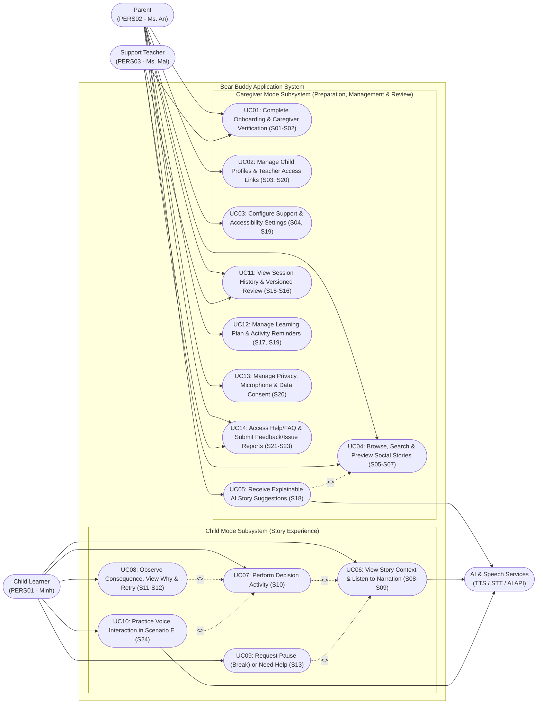
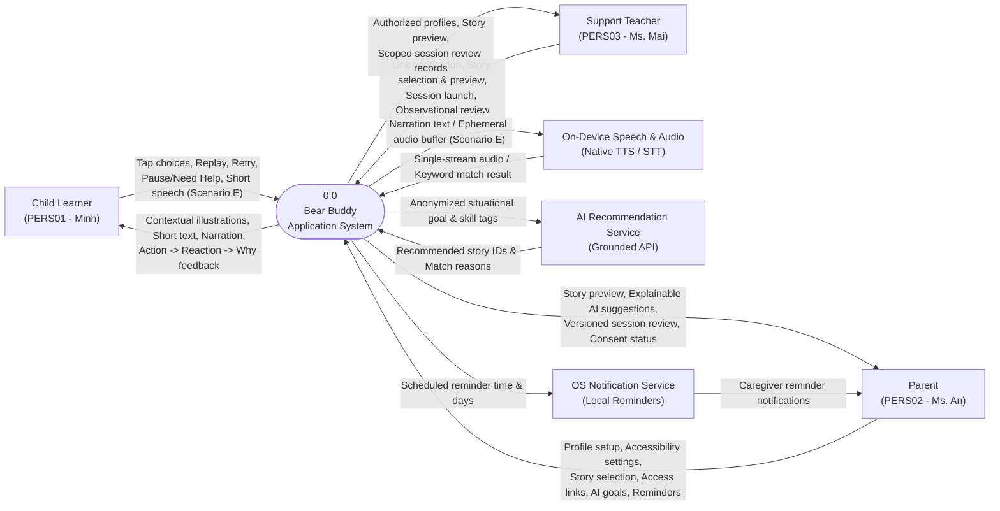
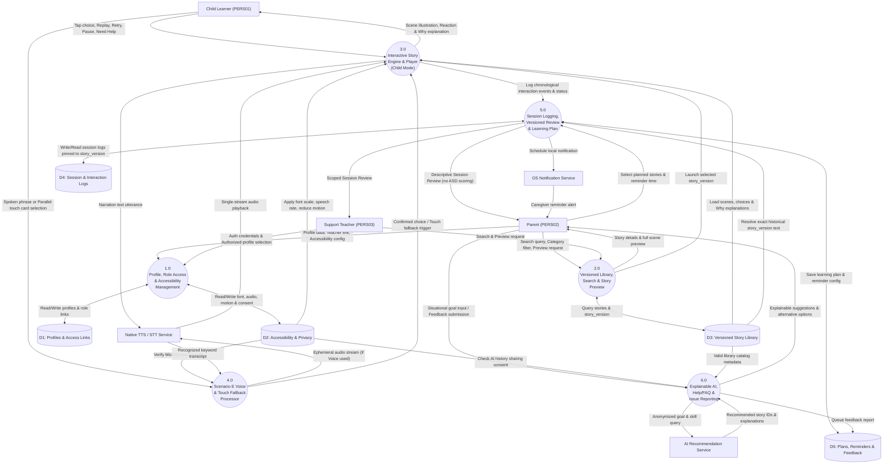

# Chapter 3. Requirement Analysis

This chapter presents the formal requirement analysis specification for the **Bear Buddy** application. It builds directly upon the problem statement in Chapter 1, the developmental capability profiles and user needs (`UN01`–`UN12`) in Chapter 2, and establishes a traceable foundation for story content design in Chapter 4, UI-UX design decisions (`DD1`–`DD40`, screens `S01`–`S24`) in Chapter 5, and system architecture in Chapter 6.

## 3.1 Stakeholders and Roles

The Bear Buddy system involves multiple stakeholder groups who either directly interact with the application or participate in content authoring, clinical/educational review, and technical operation. Role permissions are strictly separated to safeguard children's data privacy and prevent administrative complexity from leaking into the child's learning flow (`DD31`, `DD32`).

### 3.1.1 Primary Stakeholders (Direct Users)

| Stakeholder | Persona Reference | System Role | Permissions and Access Boundaries |
|---|---|---|---|
| **Child Learner (Primary User)** | `PERS01` Minh | Direct participant who experiences social stories and practices interactive activities in **Child Mode**. | Accesses only the story session launched by a caregiver; views scenes, listens to narration, selects options, uses `Replay`, `Retry`, `Pause` (*Take a Break*), or `Need Help`. Cannot access settings, profile management, or analytics. |
| **Parent (Primary Caregiver)** | `PERS02` Ms. An | Primary adult companion in **Caregiver Mode**, responsible for managing the child's profile and deciding learning content. | Full authority to create, edit, and delete child profiles under their guardianship; configures support and accessibility settings; selects stories, uses AI suggestions, reviews session logs, schedules reminders; grants or revokes teacher access links; manages data privacy and microphone permissions. |
| **Support Teacher (Authorized Caregiver)** | `PERS03` Ms. Mai | Adult companion in classroom or individualized support settings operating under parent-approved profile linking. | Views and operates only the specific child profiles explicitly linked and authorized by the parent; browses the library, previews stories, initiates learning sessions with the child, and reviews session logs within the granted scope. Cannot delete child profiles or re-share profiles with third parties. |

### 3.1.2 Secondary Stakeholders (Authoring, Operations, and External Services)

* **Content Authors and Special Education Reviewers**: Responsible for authoring social story scripts, formulating `Action` $\rightarrow$ `Reaction` $\rightarrow$ `Why` explanations, preparing visual illustrations, and recording narration following the workflow in Section 2.2.3. Every published story release must carry an explicit version identifier (`story_version`), responsible author/reviewer metadata, and publication date so that historical session logs remain pinned to the exact version the child experienced.
* **Development and Maintenance Team**: Designs, implements, and maintains the mobile application, the local SQLite database, the interactive story engine, error handling states, and privacy enforcement mechanisms.
* **Platform and External Services**:
  * *On-Device Speech and Audio Services*: Provides single-stream narration playback / Text-to-Speech (`AVSpeechSynthesizer`) and bounded phrase recognition for Scenario E (`SFSpeechRecognizer`).
  * *AI Recommendation Service*: Receives parent-specified situational goals (and anonymized session history if opted in) to recommend appropriate stories from the existing library alongside transparent explanations.
  * *OS Local Notification Service*: Executes scheduled activity reminders configured by the caregiver on the device.

## 3.2 Functional Requirements

The functional requirements below operationalize the functional scope defined in Section 1.4.2 and the user needs `UN01`–`UN12` in Section 2.6.3. Each requirement is prioritized using the **MoSCoW** method (`Must`, `Should`, `Could`, `Won't in v1`) and paired with verifiable **Acceptance Criteria**.

### 3.2.1 Onboarding, Accounts, Child Profiles, and Access Control

| FR ID | Source Need | Functional Requirement Description | MoSCoW | Acceptance Criteria |
|---|---|---|---|---|
| **FR01** | `UN07`, `UN11` | The system shall provide an Onboarding flow introducing the product's purpose, the separation between **Caregiver Mode** and **Child Mode**, and guidance on the adult companion role (`S01`). | Must | First-time users launching the app must see the segmented introduction screen `S01`; the guide remains accessible at any time via the Help section (`S21`). |
| **FR02** | `UN08`, `UN11` | The system shall support caregiver authentication or a protected local `Caregiver Gate` to isolate management functions from the child's interface (`S02`). | Must | Every transition from `Child Mode` to `Caregiver Mode` or access to data/privacy settings (`S19`, `S20`) requires passing caregiver verification; a single tap by a child cannot open management screens. |
| **FR03** | `UN06`, `UN08`, `UN11` | The system shall allow parents to create, edit, and select child profiles with minimal personal data (display name/nickname, avatar) and functional support preferences (`S03`, `S04`). | Must | Profile creation forms do not require sensitive medical records or diagnostic ASD scores; profiles save to SQLite and display the active profile indicator on `Caregiver Home` (`S05`). |
| **FR04** | `UN08`, `UN11` | The system shall allow parents to generate an access link or grant permission for a support teacher (`PERS03`) to access a specific child profile, and revoke that permission at any time (`S03`, `S20`). | Should | A teacher account only sees child profiles with an `ACTIVE` parent-approved link; when a parent revokes access in `S20`, the profile is immediately removed from the teacher's accessible list. |
| **FR05** | `UN02`, `UN03` | The system shall provide a first-time `Child Orientation` step (`S08`) featuring a simple practice scene for the child to test tapping a choice, replaying audio, and locating the `Pause` (*Break*) and `Need Help` buttons. | Must | On a profile's first session, the child can tap a sample choice, test `Replay`, and observe the fixed positions of `Pause` and `Need Help` before entering the main story. |

### 3.2.2 Situation Library, Search, and Story Preview

| FR ID | Source Need | Functional Requirement Description | MoSCoW | Acceptance Criteria |
|---|---|---|---|---|
| **FR06** | `UN07` | The system shall organize the social story library by situational categories (waiting for a turn, meeting new friends, asking to join play, asking for help, preparing for new events) on `S06`. | Must | Caregivers can browse stories by category tabs; each `Story Card` clearly displays the title, category, primary interaction type, and estimated step count. |
| **FR07** | `UN07` | The system shall allow caregivers to search stories by keyword and filter by target skill or interaction modality (`S06`). | Must | Keyword searches (with or without diacritics) return matching stories within $< 500\text{ ms}$; if no match exists, the system displays the `Empty Search` state (`S23`) with a one-tap filter reset button. |
| **FR08** | `UN07` | The system shall display a *Most Popular Social Stories* section with a transparent metric definition (based on completed sessions over the last 30 days) and clearly distinguish seeded demo items (`[Demo Seed]` / `[Sample Pick]`). | Should | When real usage statistics are unavailable, featured stories must display the `[Sample Pick]` badge rather than fabricated view counts. |
| **FR09** | `UN01`, `UN07`, `UN08` | The system shall display a `Story Details and Preview` screen (`S07`) showing the social goal, context summary, interaction modalities, expected support level, and content version code (`story_version`). | Must | Caregivers can preview all scenes and `Why` explanations on `S07` before tapping `Start with Child` to enter `Child Mode`. |

### 3.2.3 Story Player and Interactive Learning in Child Mode

| FR ID | Source Need | Functional Requirement Description | MoSCoW | Acceptance Criteria |
|---|---|---|---|---|
| **FR10** | `UN01`, `UN02`, `UN03` | The system shall present each story scene (`Story Context` - `S09`) using focused illustrations, short concrete sentences, and optional audio narration to clarify *who is involved, what is happening, and which social cues matter*. | Must | Each `S09` screen presents a single primary task/scene (`DD1`) and displays a truthful `Progress Indicator` reflecting the active story path (`DD4`). |
| **FR11** | `UN02`, `UN06` | The system shall allow playing, pausing, and replaying (`Replay`) narration for the current scene while automatically stopping prior audio when changing scenes or re-triggering playback (`S09`–`S12`). | Must | Rapidly tapping `Replay` never causes overlapping audio streams (`DD23`); advancing to a new scene immediately halts the previous scene's audio. |
| **FR12** | `UN04` | The system shall support decision activities (`Decision Activity` - `S10`) via single-tap selection on illustrated `Choice Cards` paired with short text labels. | Must | Each decision point presents 2 to 3 choices; for sequence ordering tasks, the system provides a single-tap `Tap-to-Order` mechanism alongside or instead of drag-and-drop (`DD26`, `DD27`). |
| **FR13** | `UN05` | Following each key decision, the system shall display the character's reaction (`Consequence` - `S11`) followed by the contextual reason (`Explanation` - `S12`), explicitly modeling `Action` $\rightarrow$ `Reaction` $\rightarrow$ `Why`. | Must | Feedback never uses binary *"Correct/Wrong"* labels or harsh error buzzers as primary feedback (`DD17`); it always illustrates how characters react and explains why within that specific scenario. |
| **FR14** | `UN05` | The system shall allow the child to replay the explanation (`Replay`), return to try a different choice (`Retry`) without penalty, or tap `Next` to continue (`S12`). | Must | Selecting `Try Another Way` (`Retry`) on `S12` returns the child to `S10` to explore other options; the session log records all attempts descriptively without marking retries as failures (`DD18`, `DD19`). |
| **FR15** | `UN06`, `UN10` | The system shall provide persistent `Pause` (*Take a Break*) and `Need Help` controls in fixed screen positions throughout `Child Mode` (`S08`–`S13`). | Must | Tapping `Pause` or `Need Help` stops active audio, opens a calm pause/assistance state (`S13`) with brief guidance for the accompanying adult, and preserves the exact step for resumption (`DD37`). |
| **FR16** | `UN03`, `UN06` | The system shall display a `Session End` screen (`S14`) acknowledging participation and offering options to replay the story, rest, or invite the caregiver to return to `Caregiver Mode`. | Must | Upon reaching `S14`, the system never auto-plays the next story and never uses countdown timers to pressure continued screen time (`DD34`). |

### 3.2.4 Parent AI Assistance and Scenario E Voice Interaction

| FR ID | Source Need | Functional Requirement Description | MoSCoW | Acceptance Criteria |
|---|---|---|---|---|
| **FR17** | `UN07`, `UN09` | The system shall provide an AI story recommendation feature for parents (`Parent AI Suggestions` - `S18`) based on parent-entered situational goals or permitted session history. | Should | Each suggestion on `S18` must display: (1) a valid story from the library, (2) a clear explanation of why it matches the parent's goal, and (3) an option to dismiss or browse alternative stories (`DD39`). |
| **FR18** | `UN04`, `UN09`, `UN12` | In Scenario E (`Voice Interaction Scenario E` - `S24`), the system shall allow the child to practice speaking a short structured social phrase (e.g., asking to join play or asking for help) with a model phrase prompt and parallel touch-card alternatives. | Could | The child can complete Scenario E on `S24` by tapping an illustrated choice card without speaking into the microphone (`DD36`); if speech is unclear, the screen displays *"Not heard clearly. Choose a picture or try again"* (`S23`). |

### 3.2.5 Session Review, Learning Plan, and Reminders

| FR ID | Source Need | Functional Requirement Description | MoSCoW | Acceptance Criteria |
|---|---|---|---|---|
| **FR19** | `UN08` | The system shall record and display `Session History` (`S15`) and detailed `Session Review` logs (`S16`) scoped strictly to the currently selected child profile. | Must | `S16` displays the session timestamp, exact `story_version`, sequence of choices made, explanations viewed, `Replay`/`Retry` counts, and any `Pause`/`Need Help` requests. |
| **FR20** | `UN08` | The system shall preserve historical version integrity and present review data as descriptive observations rather than diagnostic ASD scores (`S16`). | Must | When a story is updated to a newer version, `S16` for past sessions still renders the exact explanation text from the `story_version` experienced in that session; no diagnostic scoring charts are generated (`DD38`). |
| **FR21** | `UN07`, `UN08` | The system shall allow caregivers to add upcoming stories to a `Learning Plan` (`S17`) and configure local reminder notifications (`Settings and Notifications` - `S19`). | Should | Caregivers can toggle reminders and set notification times; notifications are delivered only for caregiver scheduling and never interrupt an active `Child Mode` session. |

### 3.2.6 Local Storage, System States, Support, and Privacy

| FR ID | Source Need | Functional Requirement Description | MoSCoW | Acceptance Criteria |
|---|---|---|---|---|
| **FR22** | `UN08`, `UN12` | The system shall store child profiles, accessibility configurations, downloaded stories, and session logs locally in a SQLite database. | Must | With network connectivity disabled, caregivers and children can browse local stories, complete full interactive sessions, and review saved session logs from SQLite. |
| **FR23** | `UN11` | The system shall provide a `Privacy and Access` screen (`S20`) enabling parents to control microphone permissions, AI history usage consent, teacher profile links, and session history deletion. | Must | Parents can toggle AI history sharing, revoke microphone/teacher access, and permanently delete a child's session logs or profile on `S20`. |
| **FR24** | `UN12` | The system shall provide `Help, FAQ and Contact` (`S21`) and a `Feedback and Issue Report` form (`S22`) within `Caregiver Mode`. | Must | The issue report form on `S22` validates input fields and lets the caregiver explicitly opt in or out of attaching anonymized technical/story-version logs. |
| **FR25** | `UN12` | The system shall explicitly handle and render all system states (`System States` - `S23`): `Loading`, `Empty`, `Offline`, `Content Load Error`, `Microphone Denied`, `Speech Not Recognized`, and `AI Timeout`. | Must | On content load failure or AI timeout, the system preserves the active child profile context, displays a concise user-friendly message, and provides a clear `Retry` or local fallback action (`DD40`). |

> **Scope Note (Won't have in v1)**: Version 1.0 explicitly **excludes** open-ended generative AI chat for children, **excludes** background cloud synchronization without explicit parental consent, and **excludes** public social networking across families.

## 3.3 Non-Functional Requirements (Emphasizing Accessibility)

To resolve the platform and deployment parameters noted in Sections 1.4.3 and 5.4.1, the target technical baseline is established as follows:
* **Target Platform**: Developed and verified primarily for **iOS / iPadOS** (minimum **iOS 17.0+**, built with SwiftUI and SQLite3), while maintaining cross-platform design parity with Android (minimum Android 10 / API 29).
* **Device and Data Model**: Operates as an **Offline-First Shared Single-Device** application between caregiver and child backed by local SQLite storage; cross-account sharing between parent and teacher is restricted to explicitly authorized child profiles.

### 3.3.1 Accessibility Requirements (Core Priority)

Requirements `NFR01`–`NFR08` translate the UX reasoning framework from Chapter 5 and reference WCAG 2.2 along with Apple Human Interface Guidelines (HIG) and Material Design:

* **NFR01 (Font Scaling & Typography Legibility - `DD8`, `DD9`, `DD10`)**: Critical text across both `Child Mode` and `Caregiver Mode` shall never be baked into raster images. The UI shall support Dynamic Type / font scaling up to **$200\%$** without text truncation, overlapping elements, or hidden controls. Text shall use a high-legibility sans-serif typeface with full Vietnamese diacritic support and remain static (no scrolling tickers or moving text).
* **NFR02 (Color Contrast & Non-Color State Indicators - `DD24`, `DD25`)**: Normal text shall maintain a contrast ratio of at least **$4.5:1$** against its background (e.g., primary text `#1F2937` on `#F7F9FC` or `#FFFFFF` exceeds $12:1$; primary action `#2D6253` with white text exceeds $6.5:1$). Color shall never be the sole indicator of selection, focus, or error states; borders, icons, or text labels must accompany color changes.
* **NFR03 (Generous Touch Targets & Multi-Touch Forgiveness - `DD28`, `DD29`)**: All interactive controls (buttons, `Choice Cards`, `Replay`, `Pause`, `Need Help`) shall provide an active hit target of at least **$44 \times 44\text{ pt}$** on iOS (or **$48 \times 48\text{ dp}$** on Android). Child-facing choice cards shall target a minimum height of **$\ge 64\text{ pt}$** with **$\ge 8\text{ pt}$** spacing between adjacent targets, and ignore accidental multi-finger touches or rapid double-taps.
* **NFR04 (Motor Gesture Simplicity - `DD26`, `DD27`, `DD30`)**: **$100\%$** of core story progression and decision activities shall be completable using a **Single Tap**. The system shall never require fine-motor drag-and-drop, double-tapping, multi-finger pinching, or device tilting/shaking (accelerometer) to complete a story.
* **NFR05 (Sensory Control for Audio & Motion - `DD21`, `DD22`, `DD23`)**: The audio engine shall enforce a strict single-stream policy preventing overlapping narration. Caregivers and users can mute audio, adjust narration speech rate, and enable **Reduce Motion** to replace transition animations with calm instantaneous or soft-fade state changes.
* **NFR06 (Multimodal Parity & Non-Mandatory Speech - `DD20`, `DD36`)**: Every story scene shall pair clear visual illustration, concise text, and controllable narration. No step in the application may block progression if a child does not speak into the microphone; a first-class touch alternative must always be present on screen.
* **NFR07 (Assistive Technology Compatibility)**: All interactive controls and primary scene illustrations shall expose semantic accessibility metadata (`accessibilityLabel`, `accessibilityHint`, `accessibilityRole`), while decorative background elements are marked hidden (`accessibilityHidden`) to prevent screen reader clutter.
* **NFR08 (User-Controlled Pacing - `DD34`, `DD37`)**: The system shall impose **zero countdown timers** or timed response limits in `Child Mode`. Children can pause, ask for help, or replay narration as many times as needed.

### 3.3.2 Usability and Role Separation Requirements

* **NFR09 (Shallow Navigation & Single Primary Task - `DD1`, `DD5`, `DD6`)**: Navigation depth within `Child Mode` shall not exceed 2 levels from session launch. Each screen shall present only one primary cognitive task and avoid disruptive modal popups during a story.
* **NFR10 (Positional Control Consistency - `DD2`, `DD3`)**: Core story controls (`Back`, `Replay`, `Next`, `Pause`, `Need Help`) shall maintain consistent relative positions and visual affordances across all story scenes.

### 3.3.3 Performance and Reliability Requirements

* **NFR11 (Interaction Response Latency - `DD24`)**: Tapping any choice card or control button shall produce immediate visual/audio state feedback within **$< 100\text{ ms}$**; local SQLite queries and scene transitions shall complete within **$< 300\text{ ms}$**.
* **NFR12 (Offline-First Persistence & State Recovery - `DD40`)**: All bundled/downloaded stories and session logging functions shall operate **$100\%$ offline**. If the app is backgrounded, interrupted, or paused (`S13`), the current session state shall be committed immediately to SQLite to prevent data loss.
* **NFR13 (Graceful Degradation)**: If the external AI recommendation service or speech recognizer fails or exceeds a **$5\text{-second}$** timeout, the system shall seamlessly fall back to local rule-based filtering or touch selection without crashing (target crash-free session rate $> 99.5\%$).

### 3.3.4 Privacy, Security, and Maintainability Requirements

* **NFR14 (Child Data Minimization & Ephemeral Voice Processing - `P11`, `DD33`)**: The system shall never persist raw audio recordings of a child's voice to disk or external servers during Scenario E; audio buffers are processed in volatile memory for phrase matching and discarded immediately.
* **NFR15 (Anonymized External AI Requests)**: When querying the AI recommendation service (`S18`), the system shall strip all personal identifiers (`child_id`, `nickname`, free-text personal notes) and transmit only anonymized situational goal tags and story IDs.
* **NFR16 (Modular Architecture & Content Versioning)**: The codebase shall maintain strict separation between Presentation (`Views`), State/Repository (`AppStore`, `StoryRepository`, `LocalDatabase`), Domain Models (`Models`), and Support Controllers (`Support`), with immutable `story_version` tracking for all historical session records.

## 3.4 Use Case Diagram and Use Case Specifications

The Use Case diagram below models the functional interactions between the three human actors (`PERS01` Child Learner, `PERS02` Parent, `PERS03` Support Teacher) and supporting services within the **Bear Buddy** system boundary.

### 3.4.1 Use Case Summary Table

| UC ID | Use Case Name | Primary Actor(s) | Linked FRs | Associated Screens (`S01`–`S24`) |
|---|---|---|---|---|
| **UC01** | Complete Onboarding and Caregiver Verification | Parent, Teacher | `FR01`, `FR02` | `S01`, `S02`, `S05` |
| **UC02** | Manage Child Profiles and Teacher Access Links | Parent | `FR03`, `FR04` | `S03`, `S05`, `S20` |
| **UC03** | Configure Support and Accessibility Settings | Parent | `FR03`, `NFR01`–`NFR08` | `S04`, `S19` |
| **UC04** | Browse, Search, and Preview Social Stories | Parent, Teacher | `FR06`–`FR09` | `S05`, `S06`, `S07`, `S23` |
| **UC05** | Receive Explainable AI Story Suggestions | Parent | `FR17`, `FR25` | `S18`, `S07`, `S23` |
| **UC06** | View Story Context and Listen to Narration | Child Learner | `FR05`, `FR10`, `FR11` | `S08`, `S09`, `S14` |
| **UC07** | Perform Decision Activity | Child Learner | `FR12` | `S10` |
| **UC08** | Observe Consequence, View Explanation, and Retry | Child Learner | `FR13`, `FR14`, `FR16` | `S11`, `S12`, `S14` |
| **UC09** | Request Pause (Take a Break) or Need Help | Child Learner, Caregiver | `FR15` | `S08`–`S13` |
| **UC10** | Practice Voice Interaction in Scenario E | Child Learner | `FR18`, `FR25` | `S24`, `S10`, `S23` |
| **UC11** | View Session History and Versioned Review | Parent, Teacher | `FR19`, `FR20`, `FR22` | `S15`, `S16` |
| **UC12** | Manage Learning Plan and Activity Reminders | Parent | `FR21` | `S17`, `S19`, `S23` |
| **UC13** | Manage Privacy, Microphone, and Data Consent | Parent | `FR23` | `S20` |
| **UC14** | Access Help/FAQ and Submit Feedback/Issue Reports | Parent, Teacher | `FR24`, `FR25` | `S21`, `S22`, `S23` |

### 3.4.2 Detailed Use Case Specification Tables

#### UC01 — Complete Onboarding and Caregiver Verification

| Specification Field | Details |
|---|---|
| **Use Case ID & Name** | **UC01 — Complete Onboarding and Caregiver Verification** |
| **Primary Actors** | Parent (`PERS02`), Support Teacher (`PERS03`) |
| **Description** | The adult user reviews the application's purpose, understands the companion role, and authenticates to enter `Caregiver Mode`. |
| **Preconditions** | The application is launched on the mobile device. |
| **Postconditions** | Onboarding is completed and the caregiver is granted access to `Caregiver Home` (`S05`). |
| **Main Flow** | 1. The adult opens the Bear Buddy application. 2. The system displays the `Introduction` screen (`S01`) explaining situational preparation, the separation between Caregiver Mode and Child Mode, and the scope of review logs. 3. The user proceeds to `Account Access` (`S02`) and signs in or completes the `Caregiver Gate` PIN/biometric verification. 4. The system validates credentials and opens `Caregiver Home` (`S05`). |
| **Alternative Flows** | - **3a. Switching from Child Mode to Caregiver Mode**: The adult triggers the mode switch control and completes the `Caregiver Gate`; if verification fails or is triggered accidentally by a child's tap, the system remains safely in `Child Mode` (`DD31`, `DD32`). |

#### UC02 — Manage Child Profiles and Teacher Access Links

| Specification Field | Details |
|---|---|
| **Use Case ID & Name** | **UC02 — Manage Child Profiles and Teacher Access Links** |
| **Primary Actor** | Parent (`PERS02`) |
| **Description** | The parent creates or edits a child's profile and manages granting or revoking profile access links for a support teacher (`PERS03`). |
| **Preconditions** | The parent is authenticated in `Caregiver Mode`. |
| **Postconditions** | The child profile and teacher access link permissions are persisted in SQLite. |
| **Main Flow** | 1. The parent opens `Child Profile and Linking` (`S03`). 2. The parent enters the child's display nickname, avatar, and functional communication/support preferences. 3. The parent optionally generates an access link granting a support teacher (`PERS03`) permission to view and run sessions for this profile. 4. The system validates inputs, saves the record to SQLite, and sets the profile as active on `Caregiver Home` (`S05`). |
| **Alternative Flows** | - **2a. Missing required nickname**: The system highlights the specific field with a friendly inline validation message (`Invalid Input` - `S23`) while preserving other entered values. - **3a. Revoking teacher access**: The parent navigates to `S20` or `S03` and revokes the link; the teacher's access is terminated immediately. |

#### UC03 — Configure Support and Accessibility Settings

| Specification Field | Details |
|---|---|
| **Use Case ID & Name** | **UC03 — Configure Support and Accessibility Settings** |
| **Primary Actor** | Parent (`PERS02`) |
| **Description** | The parent customizes font scaling, contrast, narration playback, motion reduction, and interaction modalities tailored to the child's sensory and motor profile. |
| **Preconditions** | A valid child profile is selected in `Caregiver Mode`. |
| **Postconditions** | Accessibility settings are saved to the child's profile and applied across all story sessions. |
| **Main Flow** | 1. The parent opens `Accessibility Setup` (`S04`) during onboarding or from `Settings` (`S19`). 2. The parent adjusts the font scale factor (up to $200\%$), toggles auto-narration, sets speech rate, enables Reduce Motion, and configures Scenario E voice participation. 3. The system renders a live preview of the selected settings. 4. The parent saves the configuration to the `accessibility_settings` table in SQLite. |
| **Alternative Flows** | - **2a. Reset to Calm Defaults**: The parent selects "Restore Default Settings" to revert all parameters to the baseline sensory-friendly configuration. |

#### UC04 — Browse, Search, and Preview Social Stories

| Specification Field | Details |
|---|---|
| **Use Case ID & Name** | **UC04 — Browse, Search, and Preview Social Stories** |
| **Primary Actors** | Parent (`PERS02`), Support Teacher (`PERS03`) |
| **Description** | The caregiver searches or filters the story library, inspects learning goals and version metadata, and previews all scenes before starting a session with the child. |
| **Preconditions** | The caregiver is in `Caregiver Mode` with an active child profile selected. |
| **Postconditions** | A story is selected and launched into `Child Mode`. |
| **Main Flow** | 1. The caregiver opens `Story Library` (`S06`) and browses by category, popular stories, or keyword search. 2. The caregiver selects a story card to open `Story Details and Preview` (`S07`). 3. The system displays the social goal, context summary, interaction types, `story_version`, and allows the caregiver to step through a full preview of the scenes and explanations. 4. The caregiver taps `Start with Child` to transition the app into `Child Mode` (`S08`/`S09`). |
| **Alternative Flows** | - **1a. No matching search results**: The system displays the `Empty Search` state (`S23`) with a button to clear filters. - **3a. Content load failure**: The system displays `Content Load Error` (`S23`), preserves the active profile context, and provides a `Retry` button. |

#### UC05 — Receive Explainable AI Story Suggestions

| Specification Field | Details |
|---|---|
| **Use Case ID & Name** | **UC05 — Receive Explainable AI Story Suggestions** |
| **Primary Actors** | Parent (`PERS02`), AI Recommendation Service |
| **Description** | The parent specifies an upcoming situation or learning goal and receives grounded story recommendations from the library accompanied by clear explanations. |
| **Preconditions** | The parent is on the `Parent AI Suggestions` screen (`S18`). |
| **Postconditions** | Recommended stories with explanations are displayed; the parent retains full authority to select or ignore them. |
| **Main Flow** | 1. The parent opens `S18` and selects or enters a situational goal (e.g., preparing for a doctor visit or joining peers at recess). 2. The system verifies AI data consent (`S20`) and sends an anonymized request to the recommendation module. 3. The system displays matching stories from the library along with a transparent explanation of why each story fits the goal (`DD39`). 4. The parent taps a recommended story to preview it (`S07`) or chooses a different story from the library. |
| **Alternative Flows** | - **2a. Device Offline or AI Timeout**: The system displays `AI Timeout or Unavailable` (`S23`) and immediately provides deterministic rule-based suggestions from the local SQLite library. |

#### UC06 — View Story Context and Listen to Narration

| Specification Field | Details |
|---|---|
| **Use Case ID & Name** | **UC06 — View Story Context and Listen to Narration** |
| **Primary Actors** | Child Learner (`PERS01`), Native TTS Service |
| **Description** | The child views the illustrated scene, reads short concrete text, and listens to audio narration to understand who is present, what is happening, and which social cues are relevant. |
| **Preconditions** | A story session has been launched into `Child Mode`. |
| **Postconditions** | The child receives the situational context (`Understand`) and is ready for the decision activity. |
| **Main Flow** | 1. If this is the child's first session, the system presents the brief `Child Orientation` screen (`S08`). 2. The system displays `Story Context` (`S09`) with focused character illustration, 1–2 short sentences, and a progress indicator. 3. The system plays the narration via `SpeechController` according to the profile's audio settings. 4. The child taps `Replay` to listen again or taps `Next` to proceed to the activity step. |
| **Alternative Flows** | - **4a. Rapid repeated taps on Replay**: The audio controller stops the active utterance and restarts cleanly from the beginning without overlapping audio streams (`DD23`). |

#### UC07 — Perform Decision Activity

| Specification Field | Details |
|---|---|
| **Use Case ID & Name** | **UC07 — Perform Decision Activity** |
| **Primary Actor** | Child Learner (`PERS01`) |
| **Description** | The child predicts and selects a behavioral response in the scenario using single-tap interaction on illustrated options. |
| **Preconditions** | The child has viewed the story context (`S09`) and reached `Decision Activity` (`S10`). |
| **Postconditions** | The child's choice is logged in the session record and the flow advances to `Consequence` (`S11`). |
| **Main Flow** | 1. The system displays a clear situational prompt and 2 to 3 `Choice Cards` with distinct illustrations and short labels (`S10`). 2. The child may tap the speaker icon on any card to hear that option read aloud. 3. The child taps a choice card (or taps cards in sequence 1 $\rightarrow$ 2 $\rightarrow$ 3 for `Tap-to-Order` activities). 4. The system immediately updates the visual selection state (`DD24`) and transitions to the `Consequence` screen (`S11`). |
| **Alternative Flows** | - **3a. Accidental multi-touch or rapid repeated taps**: The system registers only the first valid touch target and locks duplicate submissions during transition (`DD29`). |

#### UC08 — Observe Consequence, View Explanation, and Retry

| Specification Field | Details |
|---|---|
| **Use Case ID & Name** | **UC08 — Observe Consequence, View Explanation, and Retry** |
| **Primary Actor** | Child Learner (`PERS01`) |
| **Description** | The child observes how characters in the story react to the chosen action, hears the explanation of why (`Action` $\rightarrow$ `Reaction` $\rightarrow$ `Why`), and chooses whether to replay, retry another option, or continue. |
| **Preconditions** | The child has selected an option on `S10` (or `S24`). |
| **Postconditions** | The child views the explanation and either explores another branch or completes the story at `S14`. |
| **Main Flow** | 1. The system renders `Consequence` (`S11`), illustrating the character's specific reaction to the selected action. 2. The system presents `Explanation and Retry` (`S12`), explaining why the character reacted that way in this context. 3. The system provides three clear actions: `Replay` (listen again), `Try Another Way` (`Retry`), or `Next` (continue). 4. Upon completing the final scene, the system displays `Session End` (`S14`) acknowledging the child's participation. |
| **Alternative Flows** | - **3a. Child selects `Try Another Way` (`Retry`)**: The system returns to `S10` so the child can explore an alternative choice without penalty or negative judgment (`DD18`). |

#### UC09 — Request Pause (Take a Break) or Need Help

| Specification Field | Details |
|---|---|
| **Use Case ID & Name** | **UC09 — Request Pause (Take a Break) or Need Help** |
| **Primary Actors** | Child Learner (`PERS01`), Caregiver (`PERS02`/`PERS03`) |
| **Description** | The child proactively taps `Pause` (*Take a Break*) or `Need Help` at any point during a session when feeling tired, overwhelmed, or needing adult support. |
| **Preconditions** | An active story session is running in `Child Mode` (`S08`–`S12`, `S24`). |
| **Postconditions** | The session is safely paused at the current step and the event is recorded in the session log. |
| **Main Flow** | 1. The child taps the persistent `Pause` or `Need Help` button. 2. The system immediately halts all audio playback and opens the calm `Pause and Help` screen (`S13`). 3. If `Need Help` was tapped, the screen displays a concise coaching tip for the accompanying adult. 4. When ready, the child taps `Resume Story` to return to the exact step, or the adult authenticates to exit to `Caregiver Mode`. |
| **Alternative Flows** | - **4a. App closed while paused**: The system commits the `PAUSED` state and `last_step_order` to SQLite so the session can be resumed later (`S23`). |

#### UC10 — Practice Voice Interaction in Scenario E

| Specification Field | Details |
|---|---|
| **Use Case ID & Name** | **UC10 — Practice Voice Interaction in Scenario E** |
| **Primary Actors** | Child Learner (`PERS01`), On-Device Speech Recognition Service |
| **Description** | In Scenario E, when voice practice is enabled, the child practices speaking a short functional social phrase or selects a parallel touch card alternative. |
| **Preconditions** | Voice interaction is enabled for the profile and the story reaches Scenario E (`S24`). |
| **Postconditions** | The child's response (via speech or touch) is confirmed and the story advances to `Consequence` (`S11`). |
| **Main Flow** | 1. The system displays `Voice Interaction Scenario E` (`S24`) with the model phrase prompt (e.g., *"Can I play too?"*), a `Listen to Model` button, a central `Tap to Speak` button, and parallel illustrated touch cards. 2. The child taps `Tap to Speak` and says the short phrase. 3. The voice controller matches the recognized transcript against target keywords for the scenario. 4. Upon keyword match, the system confirms the choice and transitions to `Consequence` (`S11`). |
| **Alternative Flows** | - **1a. Child prefers touch or Microphone Denied (`Microphone Denied`)**: The child taps the illustrated choice card directly on `S24` to complete the step without speaking (`DD36`). - **3a. Unclear audio (`Speech Not Recognized`)**: The system displays *"Not heard clearly. Choose a picture or try again"* (`S23`) without grading pronunciation as wrong. |

#### UC11 — View Session History and Versioned Review

| Specification Field | Details |
|---|---|
| **Use Case ID & Name** | **UC11 — View Session History and Versioned Review** |
| **Primary Actors** | Parent (`PERS02`), Support Teacher (`PERS03`) |
| **Description** | The caregiver reviews the list of past sessions for the selected child profile and inspects the exact sequence of choices and explanations experienced. |
| **Preconditions** | The caregiver is authenticated and authorized for the selected child profile. |
| **Postconditions** | Version-accurate session review records are displayed descriptively. |
| **Main Flow** | 1. The caregiver opens `Session History` (`S15`) to view chronological sessions for the active child profile. 2. The caregiver selects a session to open `Session Review` (`S16`). 3. The system queries SQLite joining the exact `story_version_id` and displays the story title, version code, timestamp, choices selected, explanations viewed, and `Replay`/`Retry`/`Pause`/`Help` counts. 4. The caregiver records optional reflection notes and proceeds to plan the next activity (`S17`). |
| **Alternative Flows** | - **1a. No sessions recorded yet**: The system displays the `Empty History` state (`S23`) with a direct link to the Story Library. |

#### UC12 — Manage Learning Plan and Activity Reminders

| Specification Field | Details |
|---|---|
| **Use Case ID & Name** | **UC12 — Manage Learning Plan and Activity Reminders** |
| **Primary Actor** | Parent (`PERS02`) |
| **Description** | The parent selects upcoming stories for the child's learning plan and configures local reminder notifications. |
| **Preconditions** | The parent is in `Caregiver Mode`. |
| **Postconditions** | Planned stories and local notification schedules are saved. |
| **Main Flow** | 1. The parent opens `Learning Plan` (`S17`) from Caregiver Home or after reviewing a session. 2. The parent adds target stories to the child's plan. 3. The parent enables reminders and selects preferred days and time (`S17`/`S19`). 4. The system requests OS notification permission (if needed) and schedules local reminders via `ReminderService`. |
| **Alternative Flows** | - **4a. OS Notifications Disabled (`Notification Disabled`)**: The system saves the learning plan in SQLite, indicates that reminders are off on `S19`/`S23`, and never blocks child story access. |

#### UC13 — Manage Privacy, Microphone, and Data Consent

| Specification Field | Details |
|---|---|
| **Use Case ID & Name** | **UC13 — Manage Privacy, Microphone, and Data Consent** |
| **Primary Actor** | Parent (`PERS02`) |
| **Description** | The parent manages data collection consents, microphone usage, AI history sharing, teacher links, and data deletion. |
| **Preconditions** | The parent is authenticated in `Caregiver Mode`. |
| **Postconditions** | Privacy preferences are updated immediately and logged in `consent_audit_logs`. |
| **Main Flow** | 1. The parent opens `Privacy and Access` (`S20`). 2. The system displays current states for Microphone permission (Scenario E), AI history usage consent, and active teacher profile links. 3. The parent toggles permissions or triggers session history deletion. 4. The system applies changes immediately and records an audit entry. |
| **Alternative Flows** | - **3a. Delete entire child profile**: The system requires explicit two-step confirmation before cascading deletion of the profile and its session records in SQLite. |

#### UC14 — Access Help/FAQ and Submit Feedback/Issue Reports

| Specification Field | Details |
|---|---|
| **Use Case ID & Name** | **UC14 — Access Help/FAQ and Submit Feedback/Issue Reports** |
| **Primary Actors** | Parent (`PERS02`), Support Teacher (`PERS03`) |
| **Description** | The caregiver consults user guides and FAQs or submits an issue report / content feedback. |
| **Preconditions** | The caregiver is in `Caregiver Mode`. |
| **Postconditions** | Help content is displayed or the feedback report is queued/submitted. |
| **Main Flow** | 1. The caregiver opens `Help FAQ and Contact` (`S21`) to review companion guidance and social story principles. 2. To report an issue, the caregiver opens `Feedback and Issue Report` (`S22`). 3. The caregiver enters feedback text, chooses whether to attach anonymized `story_version`/diagnostic metadata, and taps Submit. 4. The system confirms submission (`Feedback Submission` - `S23`). |
| **Alternative Flows** | - **4a. Device Offline during submission**: The system stores the report in the local SQLite queue (`Save or Sync Pending` - `S23`) for retry when connectivity returns. |

## 3.5 Context Diagram and Data Flow Diagram

### 3.5.1 Context Diagram

The Context Diagram represents **Bear Buddy** as a single central process (`0.0 Bear Buddy Application System`) to establish the system boundary and external data exchanges.

### 3.5.2 Level 0 Data Flow Diagram (DFD Level 0)

The Level 0 Data Flow Diagram decomposes Bear Buddy into **6 core processes** and **5 local SQLite data stores**, reflecting the strict boundary between child-facing learning processes and caregiver management processes:

* **Core Processes**:
  * `1.0 Profile, Role Access & Accessibility Management`: Handles Caregiver Gate verification, child profiles, teacher access links, accessibility settings, and privacy consents (`S01`–`S04`, `S19`, `S20`).
  * `2.0 Versioned Story Library, Search & Preview`: Queries stories by category/keyword, tracks `story_version`, and renders caregiver previews (`S05`–`S07`).
  * `3.0 Interactive Story Engine & Multimodal Player (Child Mode)`: Orchestrates the child learning loop, single-stream narration, touch choices, `Action` $\rightarrow$ `Reaction` $\rightarrow$ `Why` presentation, `Replay`, `Retry`, `Pause`, and `Need Help` (`S08`–`S14`).
  * `4.0 Scenario E Voice Processing & Touch Fallback`: Manages bounded phrase practice on `S24`, checks microphone consent, matches keywords via STT, and guarantees an immediate touch-card fallback.
  * `5.0 Session Logging, Versioned Review & Learning Plan`: Records interaction events pinned to `story_version`, generates descriptive caregiver reviews, and schedules reminders (`S15`–`S17`).
  * `6.0 Explainable AI Suggestions, Help & Feedback`: Processes grounded AI story recommendations (`S18`), FAQ lookup, and issue reporting (`S21`–`S23`).
* **Internal SQLite Data Stores**:
  * `D1: Child Profiles & Access Links`: Stores caregiver accounts, child profiles, and parent–teacher access link permissions.
  * `D2: Accessibility & Privacy Settings`: Stores font scaling, contrast, audio, motion reduction, and microphone/AI consent states.
  * `D3: Versioned Story Library`: Stores stories, immutable `story_version` metadata, scene steps, choices, and explanations.
  * `D4: Session Logs & Review Records`: Stores session metadata and chronological interaction events linked to `story_version`.
  * `D5: Learning Plans, Reminders & Feedback Queue`: Stores planned stories, reminder schedules, and pending feedback reports.

### 3.5.3 Architectural Observations on System Data Flows

1. **Strict Separation of Child and Caregiver Data Flows**: The Child Learner (`PERS01`) interacts exclusively with Processes `3.0` and `4.0`. All configuration (`1.0`), content selection (`2.0`), historical review (`5.0`), and AI consultation (`6.0`) remain isolated within caregiver-authenticated processes.
2. **Version-Pinned Historical Integrity (`story_version`) across `D3` and `D4`**: When Process `5.0` renders a Session Review for a parent or teacher, it joins the interaction log in `D4` with the immutable `story_version` in `D3`, guaranteeing that adults see the exact wording and explanation the child experienced during that session.
3. **Consent-Gated AI and Voice Execution via `D2`**: Both Process `4.0` (Scenario E Voice) and Process `6.0` (Parent AI Suggestions) must verify explicit permission flags in `D2: Accessibility & Privacy` before invoking external or hardware services, while maintaining deterministic local fallbacks from `D3`.