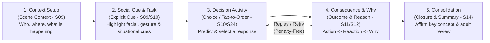

# Chapter 4. Story Content and Interaction Design

This chapter translates the theoretical foundation of Social Stories from Section 2.2, the multimodal learning principles from Section 2.3, and the UX reasoning framework (`P1`–`P11`, `DD1`–`DD40`) from Section 5.1 into the concrete story content architecture, interaction modality selection, formal specification of **Scenario E**, and non-punitive feedback rules for **Bear Buddy**.

## 4.1 Situation Library Categorization

The Bear Buddy story library is organized around everyday social situations that children encounter at home, at school, or in community settings. Structuring the library into clear situational themes enables parents (`PERS02`) and teachers (`PERS03`) to quickly locate preparatory content before an upcoming real-world event (`UN07`).

### 4.1.1 Four Core Situational Categories

| Category Code | Category Name | Social Preparation Goal | Representative Stories in Scope |
|---|---|---|---|
| **CAT01** | **Waiting and Shared Routines** | Helps the child recognize cues that an activity requires taking turns or sharing space, understand what to do while waiting, and know when their turn arrives. | - *Waiting for a Turn on the Slide* - *Quiet Reading Time in the Classroom* - *Lining Up to Wash Hands* |
| **CAT02** | **Peer Entry and Social Play** | Helps the child observe what peers are doing, identify an appropriate moment to approach, ask or signal to join play, and respond when peers agree or are busy. | - *Saying Hello to a New Classmate* - *Asking to Join a Ball Game* - *When a Request to Play Is Not Accepted Yet* |
| **CAT03** | **Needs Expression and Help-Seeking** | Helps the child recognize when a task is difficult or sensory input is overwhelming, locate a trusted adult/peer, and express a need for help or a break via touch, picture card, or short phrase. | - *Asking a Teacher or Parent to Open a Box* - *Telling an Adult When It Is Too Loud* - *Practicing Short Help-Seeking Phrases (Scenario E)* |
| **CAT04** | **Preparing for Novel Events and Transitions** | Helps the child anticipate step-by-step sequences, sensory sensations (sounds, touch), and adult support before visiting a new place or experiencing a schedule change. | - *Visiting the Doctor with Mom* - *Getting a Haircut* - *Moving to a New Classroom Activity* |

### 4.1.2 Standardized Metadata, Versioning, and Transparent Popularity Rules

To satisfy the content versioning requirements in Section 2.2.3 and clarify the *"Most popular social stories"* criteria from Section 1.4.2, every story in the library is governed by standardized metadata:

* **Identifier and Immutable Version (`story_id`, `story_version`)**: Each published release carries an explicit version code (e.g., `ST_JOIN_PLAY_v1.2`), recording the content author, special education reviewer, media asset sources, and publication timestamp. Whenever an explanation or decision branch is modified, the system creates a new `story_version` rather than overwriting historical records.
* **Target Support Metadata**: Specifies the primary interaction modalities used, total scene count, whether an optional Scenario E voice step is included, and preparatory guidance for the caregiver on the `Story Details` screen (`S07`).
* **Transparent Rules for "Most Popular Social Stories"**:
  * *With Real Operational Data*: Popularity is defined transparently as the *total number of completed sessions over the trailing 30-day window*.
  * *During Initial Deployment / Demo Seed*: Featured items are explicitly badged as **`[Sample Featured Story]`** (`[Demo Seed]`) rather than displaying fabricated usage numbers, accompanied by a reminder that caregivers should choose stories based on the child's current situational need rather than general popularity (`S06`).

## 4.2 Standard Structure of a Bear Buddy Story

A Bear Buddy story combines the informational structure of Carol Gray's Social Stories (10.4 Criteria) with a predictable interactive sequence (`DD2`: `Scene` $\rightarrow$ `Decision` $\rightarrow$ `Consequence` $\rightarrow$ `Explanation` $\rightarrow$ `Next`). This structure ensures the child always receives sufficient social context before making a decision (`UN01`, `DD13`).

### 4.2.1 Five Structural Stages of a Standard Story

1. **Stage 1 — Context Setup (Screen `S09`)**:
   * **Purpose**: Introduces the characters (e.g., the child character and Bear Buddy), the physical setting (classroom, playground, clinic), and the ongoing activity.
   * **Sentence Functions**: Uses concrete *Descriptive* sentences paired with observable, evidence-based *Perspective* sentences.
2. **Stage 2 — Explicit Social Cue Presentation (Screens `S09` / `S10`)**:
   * **Purpose**: Implements the core principle *Make the implicit explicit* (`P3`, `DD14`). Instead of assuming the child will infer meaning from a small facial expression, the visual highlight and narration explicitly point out the relevant cue (e.g., *"Two friends are rolling a red ball and smiling. They are looking at the ball, so they might not know I want to play yet"*).
3. **Stage 3 — Decision Activity (Screen `S10` or `S24`)**:
   * **Purpose**: Presents a single focused situational question (e.g., *"What can I do so my friends know I want to play with them?"*) accompanied by concrete illustrated action choices.
4. **Stage 4 — Consequence and Why Explanation (Screens `S11` & `S12`)**:
   * **Purpose**: Explicitly models the causal chain **`Action` $\rightarrow$ `Reaction` $\rightarrow$ `Why`** (`DD15`, `DD16`):
     * **Action (Selected Choice)**: Briefly restates the action the child selected.
     * **Reaction (Scenario Outcome)**: Illustrates and describes how the other characters in this specific scenario respond.
     * **Why (Contextual Social Reason)**: Explains why that action helped the peers understand or why it surprised/confused them in that setting, without claiming absolute laws about how all people think.
5. **Stage 5 — Consolidation and Session Closure (Screen `S14`)**:
   * **Purpose**: Summarizes the core takeaway using an *Affirmative* or gentle *Coaching* sentence, acknowledges the child's participation, and provides a calm transition to rest, replay, or return to the caregiver.

### 4.2.2 Language Rules and Sentence Ratio Control

Following the four expressive sentence functions defined in Section 2.2.2 and Carol Gray's Social Stories 10.4 Criteria, all Bear Buddy scripts adhere to strict linguistic constraints:

* **Sentence Ratio Rule ($\ge 4:1$)**: Across the narrative body of a story, the combined count of *Descriptive*, *Perspective*, and *Affirmative* sentences must be at least **four times greater** ($\ge 4:1$) than *Directive / Coaching* sentences.
* **Per-Screen Text Density Limits (`DD7`, `DD8`)**:
  * Each story scene (`S09`, `S11`, `S12`) displays only **1 to 2 short sentences** (maximum $25\text{ words}$ per screen).
  * Each `Choice Card` label on `S10` contains at most **$8\text{ to }10\text{ words}$**, beginning with a concrete action verb.
* **Avoidance of Absolute Guarantees**: Scripts use realistic qualifiers such as *"sometimes"*, *"may"*, or *"usually"* rather than absolute promises like *"everyone will always say yes"* or *"everything will be completely fine"*.

### 4.2.3 Complete Walkthrough Script: "Asking to Join a Game" (`ST_JOIN_PLAY_v1.0`)

The table below illustrates a complete screen-by-screen script for a standard interactive story in Bear Buddy:

| Scene / Screen | Sentence Function | On-Screen Text & Narration | Visual Illustration & Explicit Social Cues (`DD13`, `DD14`) | Interaction & Navigation Controls |
|---|---|---|---|---|
| **Scene 1 (`S09`)** | Descriptive | *"At recess, two friends are rolling a red ball on the grass."* | Two children sitting opposite each other rolling a red ball, smiling calmly. | `Replay` Narration / Tap `Next` |
| **Scene 2 (`S09`)** | Perspective + Descriptive | *"I like the red ball and want to play too. My friends are watching the ball, so they may not know I want to join."* | The child character stands nearby looking at the ball; a soft visual highlight indicates the peers' gaze on the ball. | `Replay` / Tap `Next` |
| **Scene 3 (`S10`)** | Coaching Prompt | *"What can I do so my friends know I want to play?"* | Displays 3 large illustrated `Choice Cards`: | - **Option A**: Walk closer and say or show card *"Can I play too?"* - **Option B**: Run in and grab the ball away - **Option C**: Stand far away in silence |
| **Branch A (`S11` $\rightarrow$ `S12`)** | Consequence + Why + Affirmative | - **Action**: *"I walked closer and asked to play."* - **Reaction**: *"My friends stopped the ball, looked at me, and made room in the circle."* - **Why**: *"When I ask clearly or show my card, my friends know I want to join the game."* | The two peers smile and scoot over to create an open spot on the grass. | `Replay` / `Try Another Way` (to Scene 3) / `Next` (to Closure) |
| **Branch B (`S11` $\rightarrow$ `S12`)** | Consequence + Why + Coaching | - **Action**: *"I ran in and grabbed the ball."* - **Reaction**: *"My friends stopped playing, looked surprised, and held onto the ball."* - **Why**: *"Taking the ball suddenly without asking can surprise my friends because they do not know I want to play together. I can try asking first."* | The peers look surprised with wide eyes, holding the ball. (No red 'X' or error buzzer is used). | `Replay` / `Try Another Way` (returns to Scene 3 without penalty) / `Next` |
| **Branch C (`S11` $\rightarrow$ `S12`)** | Consequence + Why + Coaching | - **Action**: *"I stood far away and watched quietly."* - **Reaction**: *"My friends kept rolling the ball to each other."* - **Why**: *"Because I stood far away and did not signal, my friends were busy looking at the ball and did not notice me. I can walk closer or wave."* | The child remains in the background while the two peers continue looking at the ball. | `Replay` / `Try Another Way` / `Next` |
| **Closure (`S14`)** | Affirmative + Coaching | *"When I want to join a game, walking closer and asking or waving helps my friends understand. If I feel shy, I can also ask an adult to help me."* | The child character, Bear Buddy, and the friends rolling the ball together; session end controls displayed. | `Replay Story` / `Take a Break` / `Return with Caregiver` |

## 4.3 Selection of Interaction Modalities and Scenario E Specification

In Sections 1.4.2 and 2.3.3, six candidate interaction modalities were identified for evaluation. This section analyzes the trade-offs between social learning value and motor/cognitive burden for the reference persona Minh (`PERS01`) to finalize the interaction design for Bear Buddy.

### 4.3.1 Trade-off Analysis and Selection of Interaction Modalities

| Interaction Modality | Pedagogical Purpose | Potential Barrier for Persona Minh (`PERS01`) | Final Design Decision in Bear Buddy (`DD26`–`DD30`, `DD35`) |
|---|---|---|---|
| **1. Illustrated Multiple Choice (`Choice Cards`)** | Selecting a social response and exploring `Action` $\rightarrow$ `Reaction` $\rightarrow$ `Why`. | Too many options or dense text causes cognitive/reading overload (`UXC1`, `UXC2`). | **Selected as Primary Core Modality (`Must`)**: Capped at 2–3 large cards per decision, pairing clear illustration, short label, and per-card audio readout. |
| **2. Scene Element / Character Tap (`Scene Hotspot Tap`)** | Directing attention to who to approach or which cue to notice in a scene. | Ambiguous affordance between background art and tappable areas (`UXC8`). | **Retained Conditionally (`Should`)**: Tappable hotspots must display a distinct soft highlight border and label (`DD25`), paired with an equivalent button below. |
| **3. Contextual Emotion Recognition (`Contextual Emotion Match`)** | Identifying a character's emotion linked to what just happened in the story. | Matching isolated faces outside context encourages rote guessing (`UXC4`, `UXC12`). | **Retained in Contextual Form (`Should`)**: Never presented as isolated face drills; emotion questions are embedded inside the story scene alongside the causal event. |
| **4. Action / Event Sequence Ordering (`Sequence Ordering`)** | Understanding multi-step social routines (e.g., Step 1 Knock $\rightarrow$ Step 2 Greet $\rightarrow$ Step 3 Ask). | Continuous press-and-drag (`Drag & Drop`) demands fine motor precision and causes accidental drops (`C6`, `UXC7`). | **Converted to Single-Tap `Tap-to-Order` (`Must`)**: The child simply **taps** cards in order to fill slots 1, 2, and 3; drag-and-drop is never required (`DD26`, `DD27`). |
| **5. Free-Form Drag and Drop (`Free Drag & Drop`)** | Moving objects freely across the canvas. | High motor friction that distracts from social comprehension. | **Excluded from Core Flow**: Replaced by `Tap-to-Order` and single-tap `Choice Cards`. |
| **6. Voice Interaction (`Scenario E`)** | Practicing short functional spoken phrases for peer entry or help-seeking. | Reluctance to speak, noisy environments, or recognition errors causing frustration (`UXC11`, `UXC17`). | **Bounded Optional Modality in Scenario E (`Could`) with Mandatory Touch Fallback (`DD36`)**: Specified in detail in Section 4.3.2 below. |

### 4.3.2 Detailed Specification of Scenario E (Voice Interaction Scenario E)

To formally resolve the open design item noted in Sections 1.1, 1.4.2, and Screen `S24` in Section 5.5.3, **Scenario E** is specified as follows:

* **Definition and Pedagogical Scope of Scenario E**:
  * **Scenario E** (*Expressive Short-Phrase Practice Scenario*) is an optional, structured expressive practice step located at the end of selected stories in **CAT02 (Peer Entry)** and **CAT03 (Help-Seeking)**. It is activated only when the caregiver has enabled Scenario E voice support in the child's profile (`S04`).
  * Rather than open-ended AI conversation, Scenario E focuses exclusively on **short, functional social phrases of 3 to 6 words/syllables** directly tied to the story scene:
    1. Help-seeking phrase: *"Help me please"* (*"Giúp con với"* / *"Cô giúp con nhé"*).
    2. Peer-entry phrase: *"Can I play too?"* (*"Cho mình chơi cùng nhé"*).
    3. Break-request phrase: *"I need a break"* (*"Con muốn nghỉ một chút"*).
* **Interaction Flow and Bounded Response Rules on Screen `S24`**:
  1. **Model Prompt and Dual-Path Layout**: Screen `S24` displays the story scene, a `Listen to Model Phrase` button, a large central `Tap to Speak` button, and **always displays 2 illustrated touch choice cards in parallel** directly below (e.g., Card 1: *"Say or show card: Can I play too?"* and Card 2: *"Wait a little longer"*).
  2. **Bounded Keyword Matching**: When the child taps `Tap to Speak`, the system listens for up to **$4\text{ seconds}$** using on-device speech recognition and checks whether the transcript contains the core functional keyword(s) (e.g., *"help"*, *"play"*, *"break"*). The system **never** grades pronunciation accuracy and **never** generates unconstrained LLM replies to the child.
  3. **Mandatory Non-Punitive Fallback**:
     * If the child taps an illustrated choice card directly without touching the microphone button: The system plays the model phrase audio and advances immediately to `Consequence` (`S11`) as a fully valid completion.
     * If speech is not recognized (`Speech Not Recognized`): The screen displays the calm prompt *"Not heard clearly. Choose a picture or try again"* (`S23`). After at most 2 unclear attempts, the system gently highlights the illustrated touch card so the child can proceed effortlessly without frustration.

## 4.4 Feedback Rules and the Core Learning Loop

### 4.4.1 Six-Stage Core Learning Loop

Every story session in Bear Buddy operates around a consistent six-stage learning loop:

$$\text{Understand} \longrightarrow \text{Predict} \longrightarrow \text{Choose} \longrightarrow \text{Observe} \longrightarrow \text{Understand Why} \longrightarrow \text{Repeat}$$

* **Understand**: Absorb *Who – Where – What is happening* through focused illustration and narration on `S09`.
* **Predict**: Notice the highlighted social cue and anticipate how characters might feel or respond on `S09`/`S10`.
* **Choose**: Express a decision via single-tap cards on `S10` (or bounded voice/touch on `S24`).
* **Observe**: Watch the character's concrete reaction unfold in the scenario on `S11`.
* **Understand Why**: Hear and read the contextual explanation linking the action to the reaction on `S12`.
* **Repeat**: Freely use `Replay` to listen again or `Retry` to explore alternative choices at the child's own pace before moving forward.

### 4.4.2 Non-Punitive Feedback Rules

To enforce the principles *Explain, Don't Judge* (`P4`) and *Safe to Explore and Repeat* (`P8`), Bear Buddy applies strict feedback rules across all interactive steps:

| Design Dimension | Prohibited Anti-Patterns | Bear Buddy Standard Feedback Rule (`DD15`–`DD19`) |
|---|---|---|
| **Evaluative Language** | Displaying *"Wrong!"*, *"Incorrect!"*, *"Bad choice"*, or deducting points/stars. | Neutrally restates the chosen action and links it to the character's reaction in context (*"When I..., my friend might..."*). |
| **Visual & Auditory Signals** | Flashing red error borders, harsh vibrations, or negative buzzer sound effects. | Maintains the calm color palette (`#F7F9FC`, `#2D6253`, `#F4D06F`), depicts natural surprised/confused character expressions in the illustration, and uses a calm narrator voice. |
| **Retry Guidance (`Retry`)** | Forcing immediate repetition without explanation, or locking the child out of exploring other branches. | Always presents the *Why* explanation first, then gently invites exploration (*"I can try asking my friend first to see what happens"*) via the `Try Another Way` button. |
| **Caregiver Session Logging** | Computing percentage accuracy scores or diagnostic social competence grades. | Logs the descriptive sequence of choices explored, explanations viewed, and `Replay`/`Retry` counts for caregiver reflection (`DD38`). |