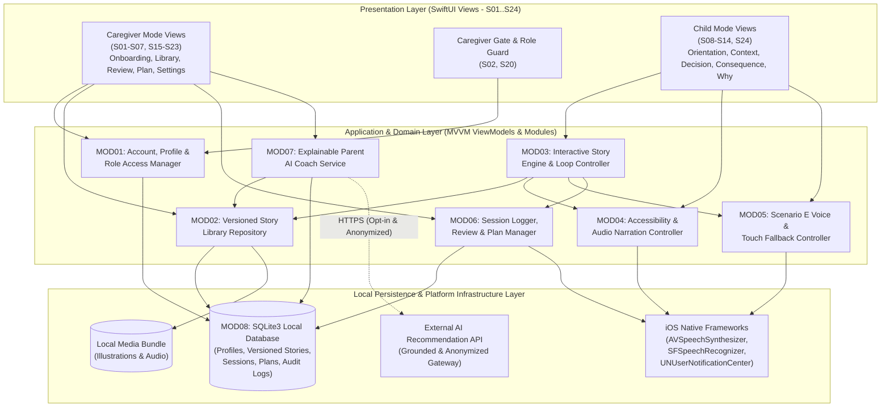
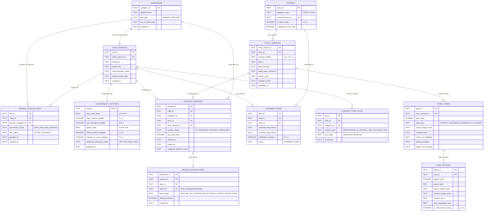
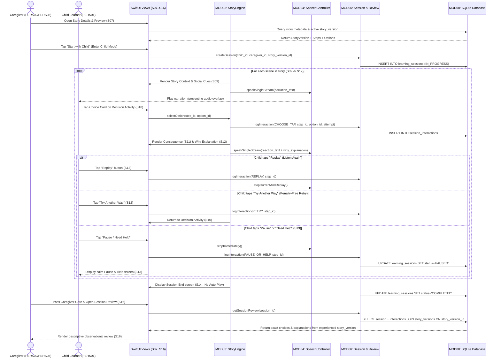
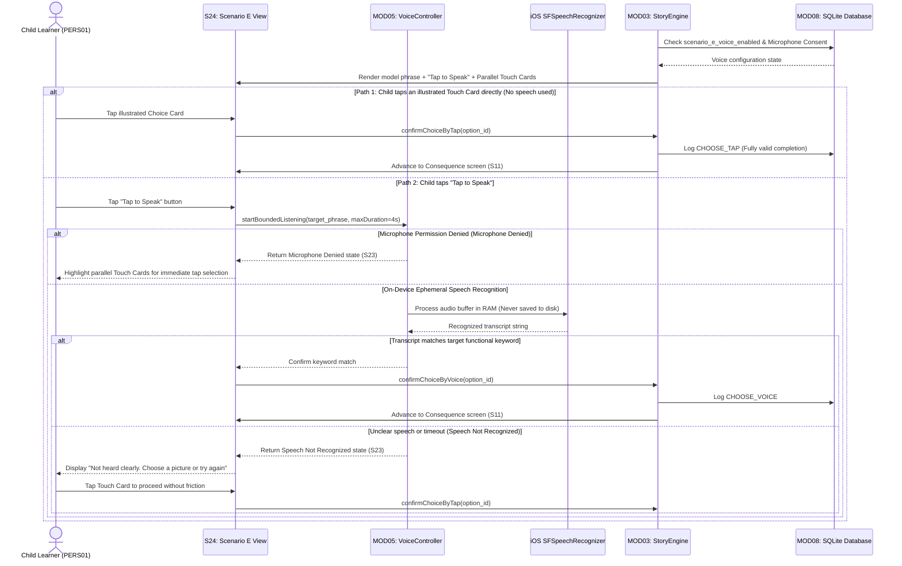
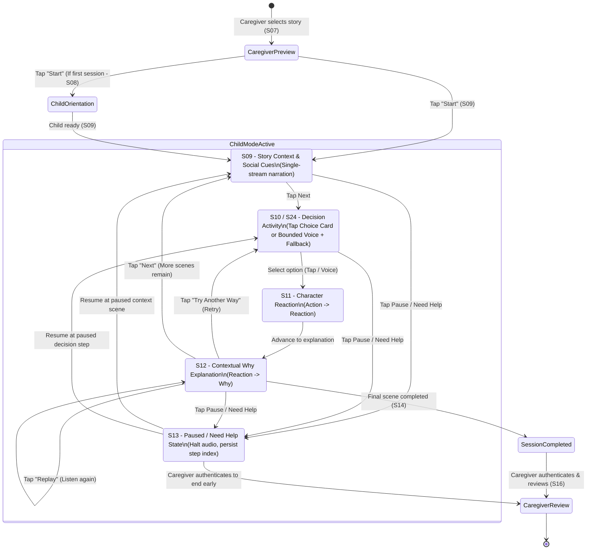

# Chapter 6. System Architecture and Design

This chapter presents the overall system architecture, module design, SQLite relational database schema, sequence diagrams, state machine diagram, AI and voice interaction architecture, and privacy/security design for **Bear Buddy**. All technical decisions in this chapter are aligned with the requirements in Chapter 3, the story interaction model in Chapter 4, and the UI-UX specifications in Chapter 5.

## 6.1 Architectural Overview and Technology Stack

### 6.1.1 Offline-First and Mode-Separated Architecture

Bear Buddy adopts a **Modular Offline-First Client Architecture** structured around the **MVVM (Model – View – ViewModel)** pattern on mobile devices. This architecture directly addresses the core constraints of the domain:

1. **Zero Network Dependency for the Child Learning Flow (`FR22`, `NFR12`)**: All bundled/downloaded social stories, visual illustrations, narration controllers, and the SQLite database reside locally on the device. A child (`PERS01`) can complete stories reliably at home or in a classroom without internet connectivity.
2. **Strict Isolation between Child Mode and Caregiver Mode (`DD31`, `DD32`)**: The application state coordinator (`AppStore` / `SessionCoordinator`) segregates the child view hierarchy (`S08`–`S14`, `S24`) from the caregiver management hierarchy (`S01`–`S07`, `S15`–`S23`) behind the `CaregiverAuthGuard` verification boundary.
3. **Fault-Isolated AI and Speech Adapters**: External AI story recommendation and on-device Scenario E speech recognition are encapsulated behind adapter interfaces with strict timeouts and deterministic local fallbacks, guaranteeing that service failures never block or interrupt a child's story session (`NFR13`, `DD36`, `DD40`).

### 6.1.2 Technology Choices and Cross-Device Data Strategy

| Architectural Layer | Selected Technology | Rationale and Alignment with Bear Buddy Requirements |
|---|---|---|
| **Mobile Platform & UI Framework** | **iOS / iPadOS 17.0+** with **SwiftUI** | Declarative reactive UI with native support for Dynamic Type ($200\%$ font scaling), VoiceOver, Reduce Motion, and precise hit-target sizing (`NFR01`–`NFR07`). |
| **Frontend Architecture** | **MVVM (Model – View – ViewModel)** | Decouples the interactive story state machine (`Understand` $\rightarrow$ `Predict` $\rightarrow$ `Choose` $\rightarrow$ `Observe` $\rightarrow$ `Why` $\rightarrow$ `Repeat`) from SwiftUI views, enabling deterministic unit testing of story branches and system states (`S23`). |
| **Local Relational Database** | **SQLite3** (`LocalDatabase`) | Lightweight, ACID-compliant relational storage with foreign-key enforcement; supports structured multi-version story storage (`story_version`), role-based access links, and granular interaction logs without requiring a mandatory backend server. |
| **Cross-Device Data Exchange Strategy** | **Local SQLite + Controlled Encrypted Sync/Export Package** | Addresses the architectural note in Section 1.4.2: SQLite serves as the primary local source of truth; when a parent (`PERS02`) links a profile with a support teacher (`PERS03`), only the authorized child profile and versioned session logs are synchronized/exported within the explicitly granted scope. |
| **Audio Narration & Speech Recognition** | **AVFoundation (`AVSpeechSynthesizer`)** & **Speech (`SFSpeechRecognizer`)** | Enables single-stream audio queue management to prevent overlapping narration (`DD23`), adjustable Vietnamese speech rates, and on-device keyword recognition for Scenario E. |
| **Local Activity Reminders** | **UserNotifications (`UNUserNotificationCenter`)** | Schedules caregiver activity reminders locally on the device without relying on third-party push notification servers. |

## 6.2 Module Design and Complete Traceability Matrix

### 6.2.1 Module Responsibilities

The system is decomposed into 8 cohesive modules (`MOD01`–`MOD08`):

* **`MOD01` — Account, Profile & Role Guard Module (`ProfileModels`, `CaregiverGate`)**: Manages caregiver authentication, child profile CRUD, role-based access control between Parent (`PERS02`) and Support Teacher (`PERS03`), and privacy consent audit logging (`consent_audit_logs`).
* **`MOD02` — Versioned Story Library Module (`StoryRepository`, `StoryModels`)**: Manages story retrieval across the 4 situational categories (`CAT01`–`CAT04`), keyword/filter queries, transparent popularity metrics, and immutable `story_version` resolution.
* **`MOD03` — Interactive Story Engine Module (`StoryPlayerViewModel`)**: The core state machine governing `Child Mode` sessions, handling `Choice Card` and `Tap-to-Order` inputs, routing `Action` $\rightarrow$ `Reaction` $\rightarrow$ `Why` branches, and executing `Replay`, `Retry`, `Pause`, and `Need Help`.
* **`MOD04` — Accessibility & Audio Narration Module (`SpeechController`, `AppColors`)**: Applies per-profile font scaling, contrast tokens, and motion settings, and enforces single-stream narration playback so multiple taps never overlap audio.
* **`MOD05` — Scenario E Voice & Touch Fallback Module (`VoiceInteractionController`)**: Manages bounded short-phrase practice on `S24`, checks microphone permissions, performs keyword matching, and guarantees immediate touch-card fallback on error or refusal.
* **`MOD06` — Session Logger, Review & Plan Module (`ParentViews`, `ReminderService`)**: Records chronological child interaction events pinned to `story_version`, renders descriptive `Session Review` screens (`S15`, `S16`), and manages `Learning Plans` and reminders (`S17`, `S19`).
* **`MOD07` — Explainable Parent AI Coach Module (`ParentCoachService`)**: Combines local rule-based filtering with grounded AI queries to recommend library stories accompanied by human-readable match reasons (`S18`).
* **`MOD08` — Local Persistence & System State Module (`LocalDatabase`, `AppStore`)**: Provides transactional SQLite3 data access, manages the offline feedback queue (`S22`), and coordinates system/error states (`S23`).

### 6.2.2 Complete Traceability Matrix

Completing the requirement established in Section 5.7.3, the table below provides end-to-end traceability linking **User Needs (`UN`) $\rightarrow$ Requirements (`FR`/`NFR`) $\rightarrow$ Use Cases (`UC`) $\rightarrow$ UX Decisions (`DD`) $\rightarrow$ Screens (`S`) $\rightarrow$ Architecture Modules (`MOD`)**:

| User Need (`UN`) | Requirements (`FR` / `NFR`) | Use Cases (`UC`) | UX Decisions (`DD`) | Screens (`S01`–`S24`) | Architecture Modules (`MOD`) |
|---|---|---|---|---|---|
| **UN01** (Understand context prior to choice) | `FR09`, `FR10` | `UC04`, `UC06` | `DD13`, `DD14` | `S07`, `S09` | `MOD02`, `MOD03` |
| **UN02** (Participate without independent reading) | `FR05`, `FR10`, `FR11`, `NFR01`, `NFR06` | `UC03`, `UC06` | `DD7`–`DD12`, `DD20` | `S04`, `S08`, `S09` | `MOD03`, `MOD04` |
| **UN03** (Clear orientation & predictability) | `FR05`, `FR10`, `FR16`, `NFR09`, `NFR10` | `UC06`, `UC08` | `DD2`–`DD6` | `S08`–`S12`, `S14` | `MOD03` |
| **UN04** (Forgiving tap input & non-mandatory voice) | `FR12`, `FR18`, `NFR03`, `NFR04`, `NFR06` | `UC07`, `UC10` | `DD26`–`DD30`, `DD36` | `S10`, `S24` | `MOD03`, `MOD05` |
| **UN05** (Understand Why, Replay & Retry) | `FR13`, `FR14` | `UC08` | `DD15`–`DD19` | `S11`, `S12` | `MOD03`, `MOD06` |
| **UN06** (Sensory control & self-paced learning) | `FR03`, `FR11`, `FR15`, `FR16`, `NFR05`, `NFR08` | `UC03`, `UC06`, `UC09` | `DD21`–`DD23`, `DD34`, `DD37` | `S04`, `S09`–`S14` | `MOD03`, `MOD04` |
| **UN07** (Caregiver library search & story preview) | `FR01`, `FR06`–`FR09`, `FR21` | `UC01`, `UC04`, `UC12` | `DD31`, `DD32` | `S01`, `S05`–`S07`, `S17` | `MOD01`, `MOD02`, `MOD06` |
| **UN08** (Version-pinned & profile-scoped review) | `FR02`–`FR04`, `FR19`–`FR22`, `NFR16` | `UC02`, `UC11`, `UC12` | `DD31`–`DD33`, `DD38` | `S02`, `S03`, `S15`, `S16` | `MOD01`, `MOD06`, `MOD08` |
| **UN09** (Explainable & reviewable AI suggestions) | `FR17`, `FR18`, `NFR15` | `UC05`, `UC10` | `DD36`, `DD39` | `S18`, `S24` | `MOD05`, `MOD07` |
| **UN10** (Child agency to Pause or Ask for Help) | `FR15`, `NFR08` | `UC09` | `DD37` | `S08`–`S13` | `MOD03`, `MOD06` |
| **UN11** (Child data minimization & access control) | `FR01`–`FR04`, `FR23`, `NFR14`, `NFR15` | `UC01`, `UC02`, `UC13` | `DD33`, `DD34`, `P11` | `S01`–`S03`, `S20` | `MOD01`, `MOD08` |
| **UN12** (Resilient error handling, Offline & Support) | `FR18`, `FR22`, `FR24`, `FR25`, `NFR12`, `NFR13` | `UC04`, `UC05`, `UC10`, `UC14` | `DD24`, `DD40` | `S21`–`S24` | `MOD05`, `MOD07`, `MOD08` |

## 6.3 SQLite Database Design

The local SQLite database (`MOD08 - LocalDatabase`) is normalized to guarantee: (1) strict separation between caregiver accounts, child profiles, and revocable teacher access links; (2) immutable multi-version story storage (`story_versions`) so historical session reviews remain accurate even after content updates; and (3) descriptive, non-punitive interaction logging.

### 6.3.1 Entity-Relationship Diagram (ERD)

### 6.3.2 Key Schema Design Decisions

1. **Separation of `STORIES` and `STORY_VERSIONS` (`FR09`, `FR20`)**:
   * The `STORIES` table holds the canonical story identifier and category, whereas all scene steps, choice cards, and `why_explanation_text` records belong to an immutable `STORY_VERSIONS` record.
   * `LEARNING_SESSIONS` references both `story_id` and `story_version_id`. When a caregiver opens `Session Review` (`S16`) for a historical session, the query joins on `story_version_id` to render the exact wording and explanation the child saw during that session, even if the story was subsequently updated.
2. **Non-Punitive Event Logging in `SESSION_INTERACTIONS` (`DD17`, `DD18`, `DD38`)**:
   * `SESSION_INTERACTIONS` intentionally omits `score` or `is_wrong` columns. Instead, it records a chronological stream of behavioral events (`CHOOSE_TAP`, `CHOOSE_VOICE`, `REPLAY`, `RETRY`, `PAUSE`, `HELP`) alongside `attempt_number`, allowing caregivers to understand how the child explored the scenario without reducing the session to a diagnostic grade.
3. **Scoped Teacher Authorization via `PROFILE_ACCESS_LINKS` (`FR04`)**:
   * Every query fetching child profiles or session histories for a user with `role_type = 'TEACHER'` enforces an `INNER JOIN` against `PROFILE_ACCESS_LINKS` filtered by `link_status = 'ACTIVE'`.

## 6.4 Sequence Diagrams and State Diagram

### 6.4.1 Sequence Diagram 1: Story Learning Flow and Version-Pinned Caregiver Review

The sequence diagram below illustrates the end-to-end flow from caregiver story preview and `Child Mode` launch, through the child's `Understand` $\rightarrow$ `Predict` $\rightarrow$ `Choose` $\rightarrow$ `Observe` $\rightarrow$ `Understand Why` $\rightarrow$ `Repeat` loop, to the version-pinned caregiver review:

### 6.4.2 Sequence Diagram 2: Scenario E Voice Interaction and Touch Fallback Flow

The second sequence diagram models the bounded voice interaction in Scenario E (`S24`), illustrating how the child can always complete the step via touch cards if microphone access is denied or speech is not recognized:

### 6.4.3 State Diagram: Story Player State Machine

The state machine diagram below specifies the lifecycle of an interactive story session, ensuring that pausing, requesting help, or encountering an error preserves the child's context (`DD37`, `DD40`):

## 6.5 AI and Voice Interaction Design

### 6.5.1 Explainable Hybrid Grounded AI Recommendation for Parents (`MOD07`)

To satisfy `UN09`, `FR17`, and `DD39`, the Parent AI Suggestion feature on screen `S18` is designed around a **Hybrid Grounded Recommendation Architecture**:

1. **Strict Library Grounding**: The AI module never fabricates unreviewed stories. Its input is strictly bounded to: (a) the situational goal selected or entered by the parent, (b) anonymizable recent story IDs (only if opted in on `S20`), and (c) the catalog of verified `STORIES` and `STORY_VERSIONS` in the library.
2. **Explainable Output Schema**: Every recommendation returned to `S18` must contain three structured fields:
   * `recommended_story_id`: A valid story identifier existing in the local library.
   * `match_reason_text`: A clear, human-readable explanation of why this story matches the parent's stated goal (e.g., *"Recommended because it introduces the stethoscope sensation and practices signaling Mom when feeling nervous at the clinic"*).
   * `alternative_category_code`: A related category tag allowing the parent to browse other options freely.
3. **Deterministic Local Rule-Based Fallback**: When the device is offline, AI history consent is disabled, or the API exceeds the **$5\text{-second}$** timeout (`AI Timeout`), `ParentCoachService` automatically switches to local keyword and category-tag matching against SQLite so the parent always receives immediate, explainable suggestions.

### 6.5.2 Bounded On-Device Voice Interaction for Scenario E (`MOD05`)

* **No Open-Ended Generative Voice Chat (`DD36`)**: To eliminate unpredictable AI responses and expressive language pressure, Scenario E (`S24`) uses native speech recognition (`SFSpeechRecognizer` with `requiresOnDeviceRecognition` enabled where supported) strictly to match keywords against pre-authored target phrases.
* **Lenient Keyword Matching & Zero Pronunciation Grading**: Detection of any core functional keyword from the model phrase (e.g., matching *"play"* or *"join"* for *"Can I play too?"*) is accepted as a valid communicative attempt.
* **First-Class Parallel Touch Alternative**: Illustrated choice cards remain visible and active alongside the microphone button on `S24` at all times.

## 6.6 Privacy and Security Design

Bear Buddy's privacy and security architecture operationalizes **Privacy and Agency by Design (`P11`)** and aligns with UNICEF's Guidance on AI and Children:

| Privacy & Security Dimension | Technical Implementation in Bear Buddy |
|---|---|
| **1. Data Minimization & Ephemeral Voice Processing (`DD33`, `NFR14`)** | - Child profiles store only a display `nickname` and functional support settings; full legal names, exact birthdates, home addresses, and clinical diagnoses are never collected. - Microphone audio in Scenario E (`S24`) is processed exclusively in volatile RAM buffers for keyword matching and deallocated immediately after the step completes; no audio files are ever written to disk or transmitted externally. |
| **2. Protected Mode Boundary (`Caregiver Gate`)** | - All transitions into `Caregiver Mode`, privacy settings (`S20`), session reviews (`S15`–`S16`), and external links are guarded by `CaregiverAuthGuard` using a caregiver PIN or OS biometric authentication (FaceID/TouchID), rather than trivial arithmetic prompts that children can guess (as noted in Section 5.2.1). |
| **3. Role-Based Access Control (`RBAC`: Parent vs. Teacher)** | - The Parent (`PERS02`) retains sole ownership (`owner_parent_id`) of the child profile. - A Support Teacher (`PERS03`) can access a profile only while an `ACTIVE` record exists in `PROFILE_ACCESS_LINKS`. Revoking the link on `S20` immediately terminates teacher access. |
| **4. Anonymization Gateway for AI Queries (`NFR15`)** | - Before `MOD07` dispatches any recommendation query, the `PrivacySanitizer` middleware strips `child_id`, `nickname`, and free-text notes, transmitting only high-level situational goal tags and story IDs. |
| **5. Parental Auditability & Right to Erasure (`FR23`)** | - On the `Privacy and Access` screen (`S20`), parents can inspect the `CONSENT_AUDIT_LOGS` history, revoke microphone or AI permissions at any time, and execute immediate cascading deletion of session histories or entire child profiles from SQLite. |