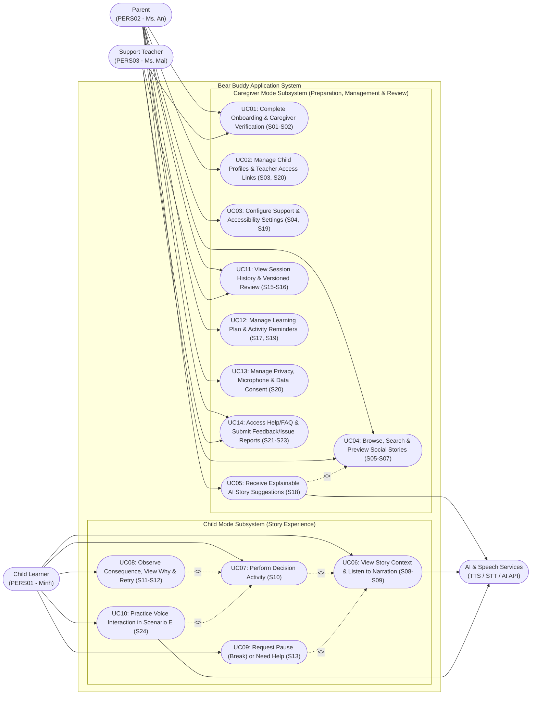
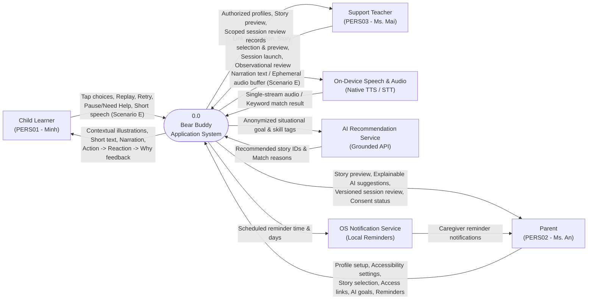
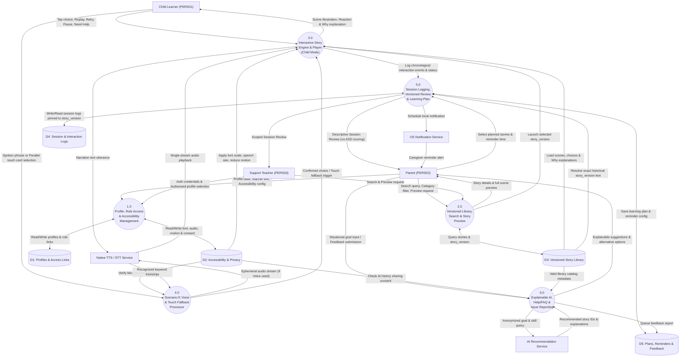
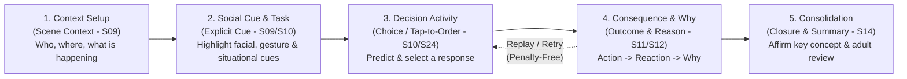
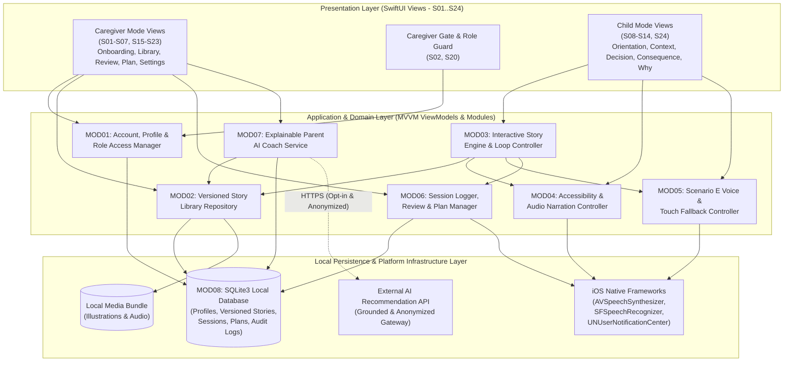
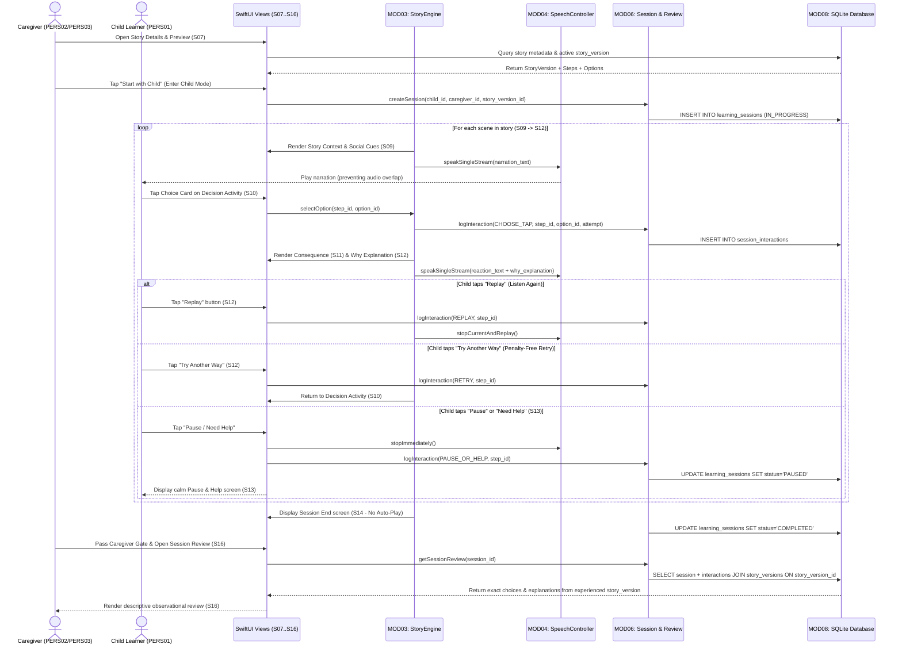
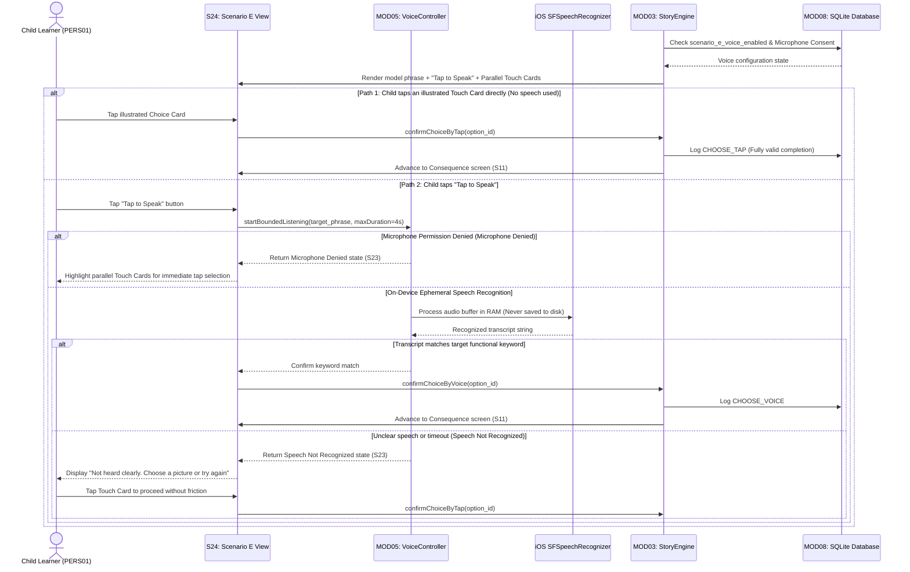
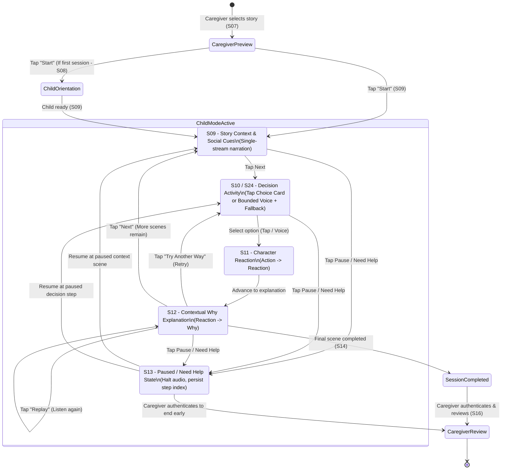

# Bear Buddy --- All 9 Mermaid Diagrams Source Code

File tổng hợp toàn bộ 9 mã nguồn Mermaid của báo cáo Bear Buddy. Bạn có thể sao chép trực tiếp vào [Mermaid Live Editor](https://mermaid.live) hoặc biên dịch bằng `mmdc` (Mermaid CLI) để xuất thành file ảnh PNG/SVG.

---

## Figure 3.1: Use-Case Diagram of the Bear Buddy System

File riêng: `diagrams/01_use_case_diagram.mmd`

---

## Figure 3.2: Context Diagram of the Bear Buddy System

File riêng: `diagrams/02_context_diagram.mmd`

---

## Figure 3.3: Level 0 Data Flow Diagram of the Bear Buddy System

File riêng: `diagrams/03_dfd_level_0.mmd`

---

## Figure 4.1: Five Structural Stages of a Bear Buddy Story

File riêng: `diagrams/04_story_five_stages.mmd`

---

## Figure 6.1: Three-Layer Offline-First Architecture Diagram

File riêng: `diagrams/05_system_architecture.mmd`

---

## Figure 6.2: SQLite Entity-Relationship Diagram (ERD)

File riêng: `diagrams/06_sqlite_erd.mmd`

```mermaid
erDiagram
    CAREGIVERS ||--o{ CHILD_PROFILES : "owns (Primary Parent)"
    CAREGIVERS ||--o{ PROFILE_ACCESS_LINKS : "granted_to (Teacher)"
    CHILD_PROFILES ||--o{ PROFILE_ACCESS_LINKS : "shared_via"
    CHILD_PROFILES ||--|| ACCESSIBILITY_SETTINGS : "configured_with"
    CHILD_PROFILES ||--o{ LEARNING_SESSIONS : "participates_in"
    CHILD_PROFILES ||--o{ LEARNING_PLANS : "has_planned"
    CHILD_PROFILES ||--o{ CONSENT_AUDIT_LOGS : "records_consent"

    STORIES ||--|{ STORY_VERSIONS : "has_versions"
    STORY_VERSIONS ||--|{ STORY_STEPS : "contains_steps"
    STORY_STEPS ||--o{ STEP_OPTIONS : "offers_choices"

    STORY_VERSIONS ||--o{ LEARNING_SESSIONS : "experienced_in"
    CAREGIVERS ||--o{ LEARNING_SESSIONS : "supervised_by"
    LEARNING_SESSIONS ||--|{ SESSION_INTERACTIONS : "logs_events"
    STORIES ||--o{ LEARNING_PLANS : "scheduled_in"

    CAREGIVERS {
        TEXT caregiver_id PK
        TEXT display_name
        TEXT role_type "PARENT | TEACHER"
        TEXT pin_or_auth_hash
        TEXT created_at
    }

    CHILD_PROFILES {
        TEXT child_id PK
        TEXT owner_parent_id FK
        TEXT nickname
        TEXT avatar_key
        TEXT communication_notes
        TEXT support_level_notes
        TEXT created_at
    }

    PROFILE_ACCESS_LINKS {
        TEXT link_id PK
        TEXT child_id FK
        TEXT teacher_caregiver_id FK
        TEXT permission_scope "VIEW_AND_RUN_SESSION"
        TEXT link_status "ACTIVE | REVOKED"
        TEXT granted_at
        TEXT revoked_at
    }

    ACCESSIBILITY_SETTINGS {
        TEXT child_id PK, FK
        REAL font_scale_factor "1.0 to 2.0"
        INTEGER high_contrast_enabled "0 or 1"
        INTEGER auto_narration_enabled "0 or 1"
        REAL speech_rate "0.35 to 0.65"
        INTEGER reduce_motion_enabled "0 or 1"
        INTEGER scenario_e_voice_enabled "0 or 1"
        TEXT preferred_interaction_mode "TAP | TAP_AND_VOICE"
        TEXT updated_at
    }

    STORIES {
        TEXT story_id PK
        TEXT category_code "CAT01..CAT04"
        TEXT current_version_id FK
        INTEGER is_demo_seed "0 or 1"
        INTEGER completion_count_30d
    }

    STORY_VERSIONS {
        TEXT story_version_id PK
        TEXT story_id FK
        TEXT version_number "e.g., 1.0, 1.1"
        TEXT title_vi
        TEXT goal_summary
        TEXT target_cues_summary
        TEXT author_name
        TEXT reviewer_name
        TEXT published_at
    }

    STORY_STEPS {
        TEXT step_id PK
        TEXT story_version_id FK
        INTEGER step_order
        TEXT step_type "CONTEXT | DECISION | SCENARIO_E | CLOSURE"
        TEXT scene_image_asset
        TEXT narration_text
        TEXT social_cue_highlight
        TEXT prompt_question
        TEXT target_voice_phrase
    }

    STEP_OPTIONS {
        TEXT option_id PK
        TEXT step_id FK
        INTEGER display_order
        TEXT option_label
        TEXT option_image_asset
        TEXT reaction_image_asset
        TEXT reaction_text
        TEXT why_explanation_text
        INTEGER is_constructive_choice "0 or 1"
    }

    LEARNING_SESSIONS {
        TEXT session_id PK
        TEXT child_id FK
        TEXT caregiver_id FK
        TEXT story_id FK
        TEXT story_version_id FK
        TEXT session_status "IN_PROGRESS | PAUSED | COMPLETED"
        INTEGER last_step_order
        TEXT started_at
        TEXT ended_at
        TEXT caregiver_reflection_note
    }

    SESSION_INTERACTIONS {
        TEXT interaction_id PK
        TEXT session_id FK
        TEXT step_id FK
        TEXT option_id FK "NULL if Replay/Pause/Help"
        TEXT action_type "CHOOSE_TAP | CHOOSE_VOICE | REPLAY | RETRY | PAUSE | HELP"
        INTEGER attempt_number
        TEXT created_at
    }

    LEARNING_PLANS {
        TEXT plan_id PK
        TEXT child_id FK
        TEXT story_id FK
        TEXT reminder_time_hhmm
        TEXT reminder_days_mask
        INTEGER notification_enabled "0 or 1"
        TEXT status "PLANNED | DONE"
    }

    CONSENT_AUDIT_LOGS {
        TEXT log_id PK
        TEXT child_id FK
        TEXT caregiver_id FK
        TEXT consent_type "MICROPHONE | AI_HISTORY_USE | TEACHER_LINK"
        TEXT new_state "GRANTED | REVOKED"
        TEXT timestamp
    }
```

---

## Figure 6.3: Sequence Diagram 1: Story Learning Flow and Review

File riêng: `diagrams/07_sequence_story_learning.mmd`

---

## Figure 6.4: Sequence Diagram 2: Scenario E Voice Interaction and Touch Fallback

File riêng: `diagrams/08_sequence_voice_interaction.mmd`

---

## Figure 6.5: State Diagram: Story Player State Machine

File riêng: `diagrams/09_state_machine.mmd`

---
